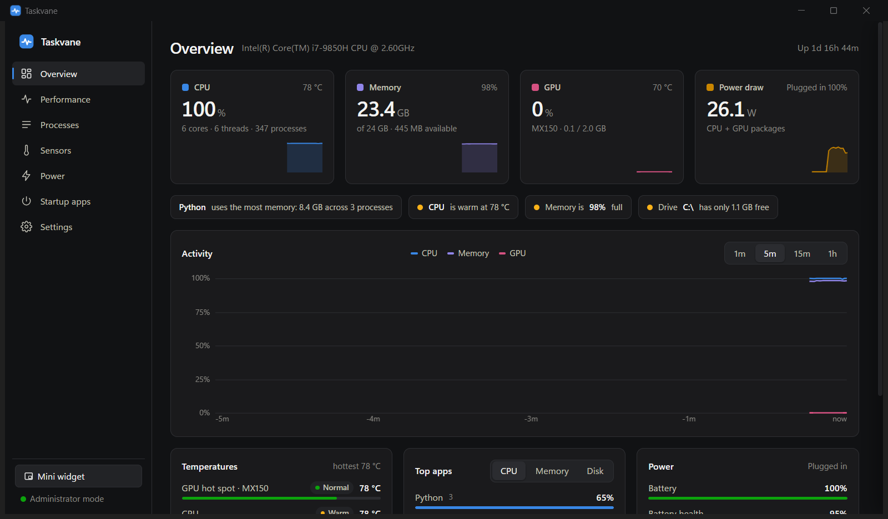
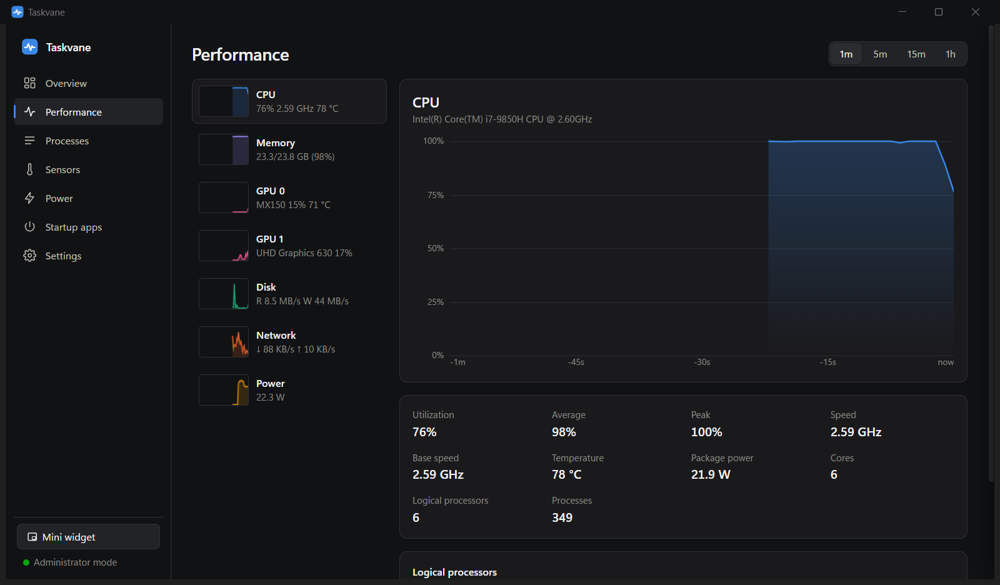
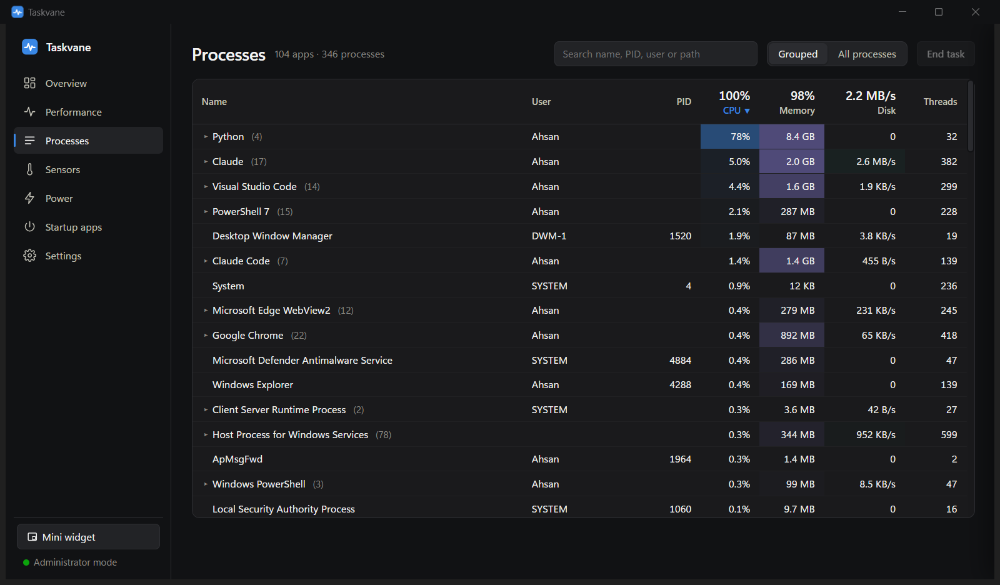
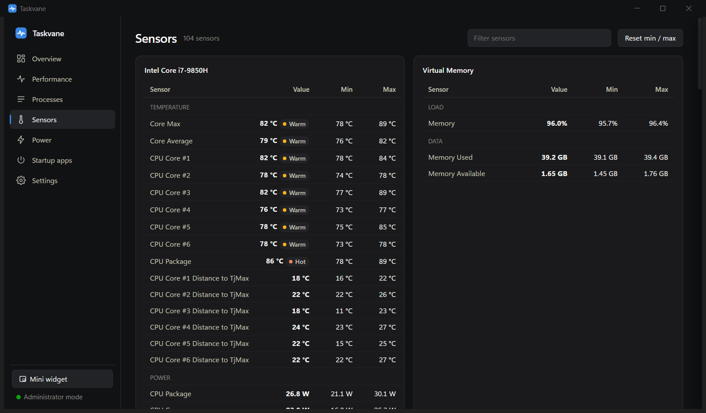
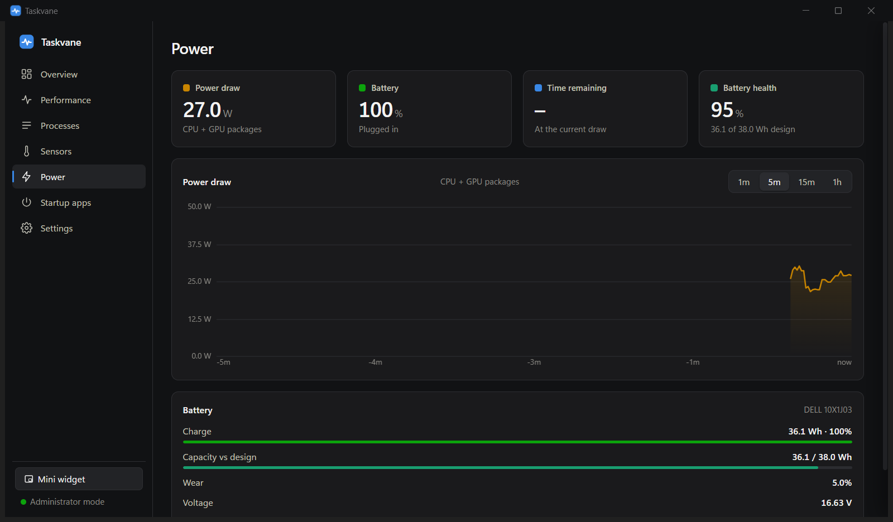

<div align="center">


# Taskvane

**A better Task Manager for Windows 11.** See CPU, GPU, memory, disk and network usage, **CPU and GPU temperatures**, and **power draw in watts**, all in one fast, free, open-source app.

[](https://github.com/Ahsuu27488/taskvane/releases/latest)
[](LICENSE)

[](https://taskvane.ahsandev.site)



</div>

## Why Taskvane?

Windows Task Manager shows usage, but not **how hot** your PC is or **how much power** it's drawing. To get those you'd normally need two or three tools (HWiNFO, Core Temp, a battery app). Taskvane combines all of it in one clean window that stays light: **about 0.4% CPU**.

- 🌡️ **Temperatures**: every CPU core and package, GPU core and hot spot, SSDs, with Normal / Warm / Hot status
- ⚡ **Power draw**: whole-system watts on battery, CPU and GPU package power, battery health, wear and time remaining
- 📊 **Performance**: Task Manager–style graphs for CPU (per core, with real clock speeds), memory, every GPU, disk and network, from 1 minute to 1 hour
- 🗂️ **Processes**: grouped by app with friendly names ("Google Chrome", not `chrome.exe`). Sort, search, end task or process tree, set priority, open file location, details
- 🚀 **Startup apps**: turn startup entries on or off, the same way Task Manager does
- 🔔 **Alerts**: Windows notifications when CPU or GPU runs hot, memory fills up, battery runs low, or the CPU stays busy
- 🪟 **Mini widget**: an always-on-top overlay with CPU, RAM, GPU, power and battery
- 🧾 **Sensors**: all 100+ hardware sensors with min/max, plus CSV export of the last hour

## Screenshots

| Performance | Processes |
|---|---|
|  |  |
| **Sensors** | **Power** |
|  |  |

## Taskvane vs Task Manager

| | Task Manager | Taskvane |
|---|:---:|:---:|
| CPU, memory, disk, network, GPU usage | ✅ | ✅ |
| CPU core and package temperatures | ❌ | ✅ |
| GPU hot-spot temperature | ❌ | ✅ |
| Power draw in watts (system, CPU, GPU) | ❌ | ✅ |
| Battery health, wear and time left at current draw | ❌ | ✅ |
| Temperature and resource alerts | ❌ | ✅ |
| Always-on-top mini widget | ❌ | ✅ |
| History graphs up to 1 hour + CSV export | ❌ | ✅ |
| Processes grouped by app, end task, priority, startup apps | ✅ | ✅ |

## Download

Get the latest version from **[Releases](https://github.com/Ahsuu27488/taskvane/releases/latest)**:

- **`Taskvane-<version>-Setup.exe`** (recommended): installs Taskvane with a Start menu entry and an uninstaller.
- **`Taskvane-<version>-Portable.zip`**: no install. Unzip and run `Taskvane.exe`; settings stay in the folder.

Requires Windows 10 (1809 or later) or Windows 11, 64-bit. The WebView2 runtime is built into Windows 11 and most Windows 10 PCs.

> **"Windows protected your PC"?** Taskvane isn't code-signed yet, so SmartScreen may warn on first run. Click **More info → Run anyway**. Each release lists SHA-256 checksums, and you can build it yourself from this source.

## CPU temperature and power: how it works

Windows only exposes CPU temperature and power to apps running as **administrator**, through a hardware driver. Taskvane uses the same open-source sensor library as [LibreHardwareMonitor](https://github.com/LibreHardwareMonitor/LibreHardwareMonitor), with the digitally signed [PawnIO](https://pawnio.eu/) driver.

- In the app, **Enable CPU sensors** restarts Taskvane as administrator and installs PawnIO. That's one UAC prompt, one time. The installer can also do this for you.
- **Settings → Always start as administrator** lets later launches start with admin rights and **no UAC prompt**, using an elevated scheduled task (as tools like HWiNFO do).
- Without admin rights you still get GPU temperatures, usage, battery power draw and health.

**Power draw while plugged in:** Windows only reports whole-system power from the battery while it's discharging. On AC power Taskvane shows CPU (and GPU, where reported) package power.

## FAQ

**Is Taskvane free?** Yes, free and open source under GPL-3.0, with no ads and no telemetry. Nothing leaves your PC.

**Is the PawnIO driver safe?** It's a digitally signed driver used by LibreHardwareMonitor and other monitoring tools, and it's only installed if you choose to. You can remove it from Settings → Apps.

**Does it slow my PC down?** No. Taskvane reads all process stats in a single system call (the same source Task Manager uses) and runs hardware sensors in a separate helper process. Total cost is about 0.4% CPU.

**Can I use it on Windows 10?** Yes, version 1809 or later, 64-bit.

## Build from source

```powershell
git clone https://github.com/Ahsuu27488/taskvane
cd taskvane
pip install -r requirements.txt
powershell -ExecutionPolicy Bypass -File tools\fetch_deps.ps1   # LibreHardwareMonitor + PawnIO, hash-verified
python app.py
```

To build `Taskvane.exe`, the portable zip and the installer (needs [Inno Setup 6](https://jrsoftware.org/isinfo.php)):

```powershell
powershell -ExecutionPolicy Bypass -File build.ps1 -Release
```

See [CONTRIBUTING.md](CONTRIBUTING.md) for the project layout and how it works.

## Command line

| | |
|---|---|
| `Taskvane.exe --minimized` | start in the notification area |
| `Taskvane.exe --quit` | close the running instance, even an elevated one (waits until it has exited) |
| `Taskvane.exe --no-elevate` | skip the "always start as administrator" hand-off for this launch |

Logs: `%APPDATA%\Taskvane\taskvane.log` (Settings → Sensor engine → Open log).

## License

Taskvane is free software under the [GNU General Public License v3.0](LICENSE). Bundled third-party components keep their own licenses; see [THIRD_PARTY_NOTICES.md](THIRD_PARTY_NOTICES.md).

---

<div align="center">

Made by **[Muhammad Ahsan](https://github.com/Ahsuu27488)** · [taskvane.ahsandev.site](https://taskvane.ahsandev.site)

If Taskvane is useful to you, please ⭐ star the repo. It helps others find it.

</div>
